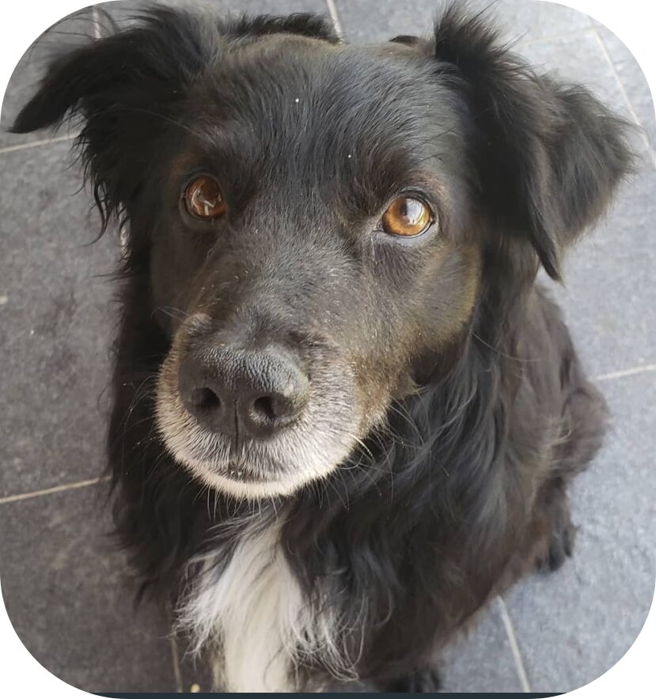

<p align="center">
  
</p>

# 🚀 OxiServer: The Polyglot Python Web Engine

> **Write Python once. Deploy it anywhere. At full speed.**

OxiServer is a high-performance, polyglot web ecosystem for serving Python applications. It allows you to ship the exact same `OxiApp` codebase to a **1.45 GB/sec C++ engine**, a **fast Julia engine**, or a **pure Python fallback** — with zero code changes.

It's not just another ASGI framework. It's a **unified server** that serves static assets at wire speed, runs CGI and PHP natively, hosts ASGI/WSGI apps, and speaks the ASGI Lifespan protocol flawlessly across three different runtimes.

---

## 🌍 The Oxi Ecosystem

Most frameworks lock you into a single runtime. Oxi doesn't. You write your app using standard ASGI/WSGI, and choose your engine at deploy time:

| Engine                  | Language | Python Mode                  | Static Speed                         | Best For                         |
| :---------------------- | :------- | :--------------------------- | :----------------------------------- | :------------------------------- |
| **`server`**    | C++      | Embedded (in-process)        | **1.45 GB/sec** (`sendfile`) | Production, maximum performance  |
| **`server.jl`** | Julia    | Subprocess (Unix socket IPC) | Near-C speed                         | REPL-driven dev, scientific apps |
| **`server.py`** | Python   | Standalone                   | Pure Python                          | Portability, zero dependencies   |

All three engines:

- ✅ Speak **ASGI 3.0** and **WSGI**.
- ✅ Serve static assets and directory listings.
- ✅ Execute **CGI and PHP** out of the box.
- ✅ Support the **ASGI Lifespan** protocol.
- ✅ Run `OxiApp`, Starlette, FastAPI, Flask, or Django.

---

## ⚡ Quickstart

### 1. Installation

```bash
# For the C++ engine (requires a C++ compiler)
git clone https://github.com/sandy98/oxi.git
cd oxi
make

# For pure Python or Julia
pip install oxi
```

## 🌍 Run the same app on any engine

### C++ Engine (Embedded CPython, 1.45 GB/sec static throughput)

./server apps.demo:app

### Julia Engine (Unix socket IPC, fast static serving)

julia server.jl apps.demo:app

### Pure Python Engine (Portable, zero compilation)

python3 server.py apps.demo:app

Open `http://localhost:8086` in your browser. The same app, the same routes, three different engines.

## ⚙️ Features

> **The C++ Engine (`server`)**
>
> * **Zero-copy static serving** via `sendfile()`.
> * **Embedded CPython 3.10** : C++ handles the sockets and HTTP parsing, while Python handles the ASGI/WSGI logic.
> * **True Lifespan** : App `on_startup` hooks block C++ socket binding until they complete. App `on_shutdown` hooks are guaranteed to fire on `Ctrl+C`.
> * **Process Isolation** : CGI scripts spawn in their own process groups with strict timeout and memory boundaries.

> **The Framework (`OxiApp`)**
>
> Built on top of the battle-tested **TinA** framework (Tiny Asynchronous).
>
> * **Flask-like routing** : `@app.get("/")`, `@app.post("/")`.
> * **Built-in Sessions & Templating** .
> * **App Mounting** : `app.mount(flask_app, "/admin")` seamlessly integrates WSGI apps inside your ASGI app.
> * **Full Lifespan Decorators** :
>
> from oxi.app import OxiApp
>
> app = OxiApp("My API")
>
> @app.on_startup
> async def connect_db():
> print("🚀 Connecting to database...")
>
> @app.get("/")
> async def index():
> return "Hello from OxiApp!"

> **CGI & PHP (Out of the box)**
>
> Drop a `.py`, `.sh`, `.pl`, `.rb`, `.java`, or `.php` file into `static/cgi-bin/`. OxiServer detects it, spawns the interpreter safely, and parses the CGI `Status:` headers natively.
>
> * No `mod_cgi` configuration.
> * No `php-fpm` setup.

> **📺 Native Video Streaming**
>
> OxiServer is fully RFC 7233 compliant. It supports HTTP Range requests natively in C++, enabling seamless video seeking and streaming in browsers, VLC, and native media players without dropping connections or exhausting memory.

---

## 📊 Benchmarks

Tested on Linux x86_64, serving a 676 KB JPEG file with `wrk -t4 -c100 -d30s`:

| Engine                    | Requests/sec          | Transfer/sec          | Notes                               |
| ------------------------- | --------------------- | --------------------- | ----------------------------------- |
| **OxiServer (C++)** | **2,298 req/s** | **1.45 GB/sec** | Thread-per-connection +`sendfile` |
| Nginx (Reference)         | ~2,400 req/s          | ~1.55 GB/sec          | Epoll event loop                    |
| Apache (mod_php)          | ~800 req/s            | ~500 MB/sec           | Process-per-request                 |

*Note: The C++ engine remains fully responsive to new connections even while under 100% load, and shuts down cleanly in `< 50ms` without dropping active requests.*

## 🏗️ Architecture (Under the Hood)

OxiServer is a **three-tier** system. When a request arrives:

1. **C++ Fast Path** : Checks if the request is a static file or a CGI script. If so, it handles it entirely in C++ using `sendfile` or `posix_spawn()`.
2. **Python Offload** : If the request is dynamic (an ASGI/WSGI route), C++ hands the raw socket file descriptor to the embedded CPython event loop via `asyncio`.
3. **Zero-Copy Bridge** : The Python app reads/writes directly to the socket, completely bypassing the C++ HTTP layer once the handoff is complete.

This hybrid approach means you get the raw network speed of C++ for static files, and the ecosystem of Python for dynamic logic.

## 🛠️ Configuration

Customize OxiServer in  `__about__.py`:

__config__ = {
    "static_dir": "static",
    "cgi_dir": "cgi-bin",
    "index_files": ["index.html", "index.htm", "index.php"],
    "allow_dirlisting": True,
    "allow_cgi": True,
    "max_body_size": 10 * 1024 * 1024,  # 10 MB limit for CGI requests
}

---

## 🗺️ Roadmap

* **☑ **C++ Engine with Lifespan & CGI
* **☑ **Julia Engine with Unix Socket IPC
* **☑ **Python Standalone Engine
* **☑ **ASGI 3.0 & WebSockets
* **☑ **WSGI Adapter (Flask/Django support)
* **□ **HTTP/2 support (coming soon)
* **□ **Multi-worker mode for C++
* **□ **Prometheus metrics endpoint

## License

MIT License. See `LICENSE` for details.

*OxiServer is the evolution of the **TinA** framework. To the original TinA users: thank you for the years of production reliability. Welcome to Oxi.*
