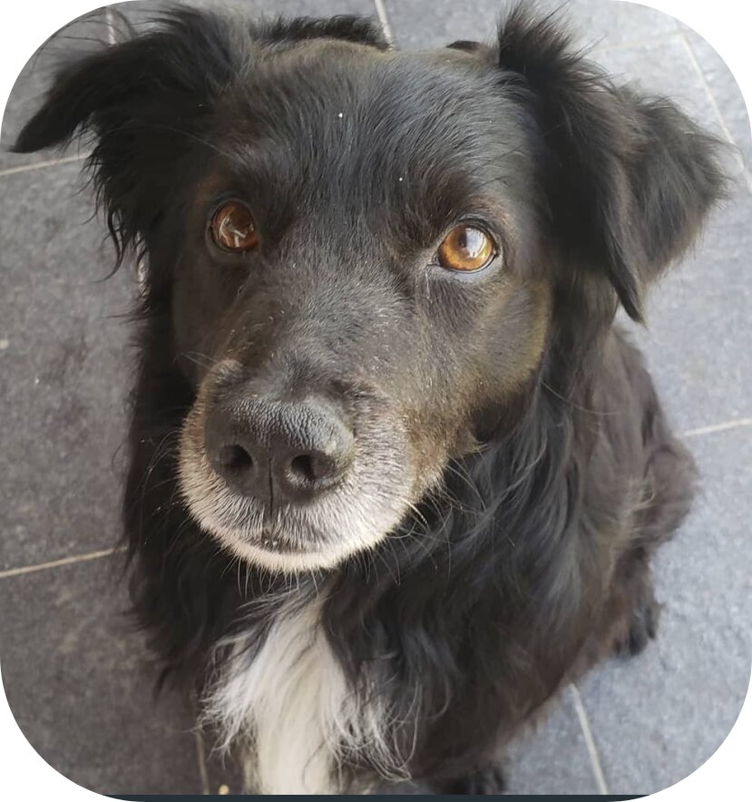

<p align="center">
  
</p>

## 🌍 Oxi: The evolution of the web

### 🚀 OxiServer: The Polyglot Python Web Engine

### 🚀 OxiApp: The post-modern ASGI framework

> **Write Python once. Deploy it anywhere. At full speed.**

OxiServer is a high-performance, polyglot web ecosystem for serving Python applications. It allows you to ship the exact same `OxiApp` codebase to a **1.45 GB/sec C++ engine**, a **fast Julia engine**, or a **pure Python fallback** — with zero code changes.

It's not just another ASGI framework. It's a **unified server** that serves static assets at wire speed, runs CGI and PHP natively, hosts ASGI/WSGI apps, and speaks the ASGI Lifespan protocol flawlessly across three different runtimes.

---

```{toctree}
:maxdepth: 2
:caption: Getting Started

quickstart
architecture
```

```{toctree}
:maxdepth: 2
:caption: The Framework

oxiapp
```

```{toctree}
:maxdepth: 2
:caption: API Reference

api
```
